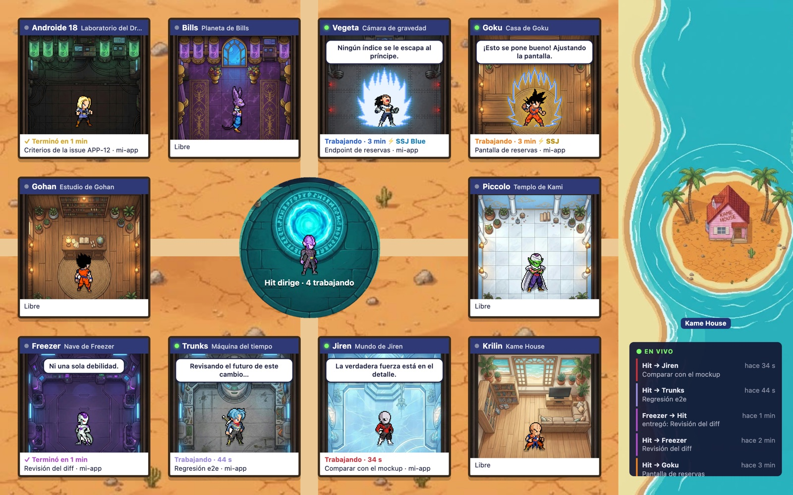

# equipo-dbs · Dragon Ball Super Agents

[Español](README.md) · **English**

A team of agents for [Claude Code](https://claude.com/claude-code) (and Cursor) starring Dragon Ball Super characters. Hit, the lead, picks up a Linear issue, splits it among ten specialists, reviews what they hand back, opens the PR and merges it. Meanwhile you can watch the team at work on a map in your browser and hear each character when they deliver.



> Fan project, non-commercial. Dragon Ball and its characters belong to their owners (see [Credits](#credits)).
>
> **Language note:** the agents, skills, voices and map are in Spanish. The agents answer in Spanish by default; you can tell them to use another language in your project's `.claude/equipo/proyecto.md`.

## What's inside

- **10 specialist agents** (`agents/`), invoked as `equipo-dbs:<role>`.
- **`resolver-issue` skill:** Hit picks up an issue («toma la issue ABC-12», "take issue ABC-12"), clarifies the goal and makes a plan. He delegates in parallel, asks for security, QA (with an e2e regression run) and design reviews, opens the PR and merges it once everything is green.
- **Map** (`mapa` skill): one room per specialist with their sprite. When Hit delegates, the character walks to their room; when they deliver, they walk back to the plaza. A live feed runs alongside.
- **Panel** (`/equipo`): in the terminal, who is working, on what and for how long, with pixel-art avatars.
- **Voices:** each character says their line when they finish and shouts when they transform. They take turns and never talk over each other.
- **Transformations:** Hit tunes each specialist's power to the task's difficulty. **Super Saiyan** = `model: opus`. **Super Saiyan Blue** = `opus` with `effort: high`.

| Role | Character | What for |
| --- | --- | --- |
| `producto` (product) | Android 18 | Goal, acceptance criteria and scope |
| `arquitecto` (architect) | Beerus | Design and impact before touching contracts or several layers |
| `backend` | Vegeta | Endpoints, services, data and migrations |
| `frontend` | Goku | Screens, styles, accessibility and performance |
| `fullstack` | Gohan | A new end-to-end contract |
| `devops` | Piccolo | CI, hosting, dependencies and merging PRs |
| `seguridad` (security) | Frieza | Diff review: authorization, XSS, personal data and secrets |
| `qa` | Trunks | Tests, real browser and e2e regression |
| `critico-diseno` (design critic) | Jiren | Compares screenshots against the mockup |
| `escritor` (writer) | Krillin | PR description and Linear comment |

## Requirements

- Claude Code (or Cursor, without the map, panel or voices).
- `git` and an authenticated [`gh`](https://cli.github.com/), for PRs.
- Optional:
  - **Linear** MCP server, to read and update issues. Without it, describe the task in the chat.
  - **CodeGraph**, used by the architect when available.
  - **Node 23.6 or newer** and `jq`, for the map.
  - **macOS**, for the voices (`afplay` and `say`); on other systems the plugin works silently.

No keys or extra accounts needed: the audio files ship with the repo.

## Installation

### Claude Code

In a session prompt:

```
/plugin install equipo-dbs --marketplace alekings-dev/dragon-ball-super-agents
```

Answer `y` to add the marketplace and pick the scope (user, by default). From the shell:

```sh
claude plugin install equipo-dbs --marketplace alekings-dev/dragon-ball-super-agents
```

In the desktop app: click **+** next to the prompt box → **Plugins** → **Add marketplace** with `alekings-dev/dragon-ball-super-agents` → **Add plugin**.

### Cursor

The same repo is a Cursor plugin (`.cursor-plugin/`), with the agents and skills:

```sh
git clone https://github.com/alekings-dev/dragon-ball-super-agents ~/.cursor/plugins/local/dragon-ball-super-agents
```

Restart Cursor and check that it shows up under **Settings → Plugins**. To update: `git -C ~/.cursor/plugins/local/dragon-ball-super-agents pull`. Use a real folder, not a symlink.

The first time you use `resolver-issue` in a repo, Hit runs `configurar-modelos`. It suggests one model per tier (Opus for Beerus and Frieza; Sonnet for the implementers, QA, product and design; Haiku for the writer) and writes `.cursor/agents/<role>.md`. Cursor silently ignores model IDs it doesn't recognize, so the skill only uses the ones you confirm.

## Getting started

1. In your repo, create `.claude/equipo/proyecto.md` with what's specific to your project. You can use the [template](#proyectomd-template). The team is generic: everything repo-specific goes in that file.
2. Ask Claude: «toma la issue ABC-12» ("take issue ABC-12") or `/equipo-dbs:resolver-issue ABC-12`.
3. To watch the team, ask «abre el mapa del equipo» ("open the team map") or run `node scripts/visor.mjs` from the plugin folder and open <http://localhost:4321>.

What each role learns is saved in `.claude/equipo/bitacora/<role>.md` and read in the following issues. Commit `.claude/equipo/` along with your code.

### `proyecto.md` template

The section headings are in Spanish because the agents look for them; write the content in whatever language you prefer.

```markdown
# Proyecto: <name>

## Producto
What it is, who it's for, tone of the copy.

## Stack
Folders, frameworks and commands (tests, types, build, run locally, e2e).

## Git y PRs
- Base branch: `<base>`.
- Commit identity and message prefixes.
- The person in charge is <name>.

## Linear
Team, project and issue prefix.

## Límites
Test users, how production is read.

## Contexto
Documents the lead should check (UX report, mockups, past decisions).

## Verificaciones finales
Commands the lead runs before the PR.

## Deploy
How devops checks the deploy after merging.

## Por rol
### backend
Own patterns and folders. (Same for other roles if needed.)
```

## How it works

### Map

`hooks/evento.sh` logs every delegation by Hit (`PreToolUse` on Agent) and every delivery (`SubagentStop`) to `~/.claude/equipo-dbs/eventos.jsonl`. The file trims itself to the last 500 lines and never leaves your machine.

`scripts/visor.mjs` serves `visor/` at `http://localhost:4321` and streams the events over SSE. It only listens on `127.0.0.1`. Names, colors, lines and transformations come from `hooks/equipo.ts`, the same file the panel uses.

```sh
node scripts/visor.mjs [port]   # or the «mapa» skill, which also opens the browser
sh hooks/evento.test.sh         # hook test
```

### Voices

`hooks/agente-termina.sh` (`SubagentStop` and `Stop` hooks) plays each character's line when they deliver. Hit speaks when his reply carries the `(⌐■_■) Hit` signature. If the report contains a blocker, such as a **Bloquea** finding or new QA failures, the alert version plays. `hooks/transformacion.sh` makes the character shout when they come in transformed.

The hooks run in parallel, so `hooks/turno.sh` gives the floor to one voice at a time with a lock in `$TMPDIR`: nobody talks over anybody, not even Hit. Test: `sh hooks/turno.test.sh`.

The audio files live in `hooks/voces/`. To regenerate them or change the lines, edit `hooks/voces.tsv` and `hooks/transformaciones.tsv`, and run the script with **your own** [Fish Audio](https://fish.audio) key. The key is only read from the environment and never stored in the repo:

```sh
FISH_API_KEY=your-key sh hooks/generar-voces.sh      # -f to overwrite existing files
```

Without audio files, the plugin falls back to the system voice (`say`).

### Avatars and sprites

- **Panel avatars:** original pixel art (16×16), generated by `scripts/generar-avatares.py` into `hooks/avatares.ts`. They render in terminals with graphics support (Kitty, iTerm2, WezTerm, Ghostty); elsewhere the character's emoticon is shown.
- **Map characters:** fan-made sprites. `scripts/importar-sprites.py` removes their background and builds one sheet per role (idle, walk, aura, deliver, fall); requires Pillow.
- **Map backgrounds:** AI-generated illustrations, in `visor/fondos/`.

## Credits

- Map sprites: the fan collection «Dragon Ball Sagas», with each author listed in [`visor/sprites/CREDITOS.md`](visor/sprites/CREDITOS.md).
- Voices: generated with public voices from [Fish Audio](https://fish.audio).
- Dragon Ball, Dragon Ball Super and their characters are the property of their respective owners. This is a non-commercial fan project with no affiliation with them.

## License

The code and documentation are licensed under [MIT](LICENSE). The license does not cover the Dragon Ball characters, the fan-made sprites (`visor/sprites/`), the backgrounds (`visor/fondos/`) or the audio files (`hooks/voces/`).
