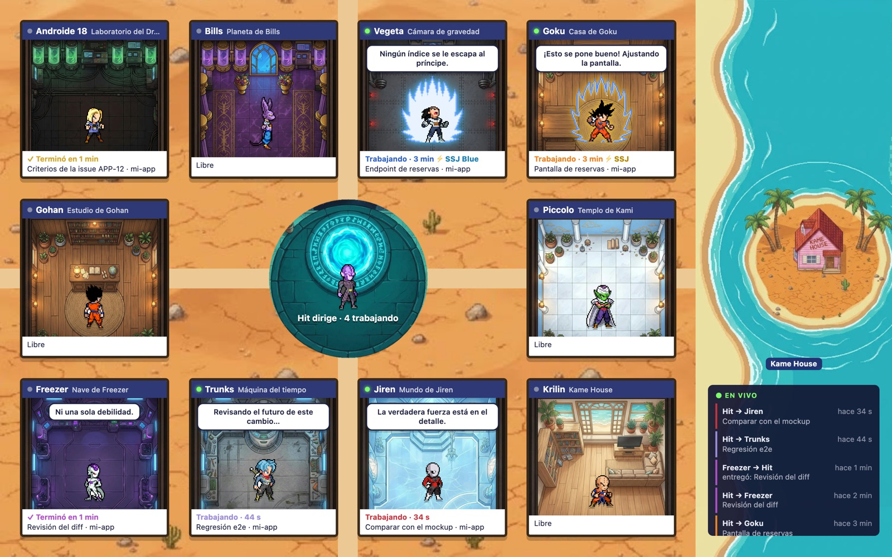

# equipo-dbs · Dragon Ball Super Agents

[Español](README.md) · **English**

A team of agents for [Claude Code](https://claude.com/claude-code), Cursor and [OpenCode](https://opencode.ai) starring Dragon Ball Super characters. Hit, the lead, picks up a Linear issue, splits it among ten specialists, reviews what they hand back, opens the PR and merges it. Meanwhile you can watch the team at work on a map in your browser and hear each character when they deliver.



> Fan project, non-commercial. Dragon Ball and its characters belong to their owners (see [Credits](#credits)).
>
> **What's new in 0.10.0:** the repo is also an **OpenCode V2** plugin. It ships the 10 agents, the 3 skills, the `/resolver-issue`, `/mapa` and `/configurar-modelos` commands, the `/equipo` TUI panel, voices and the map. Claude Code and Cursor keep working the same.
>
> **Language note:** the agents, skills, voices and map are in Spanish. The agents answer in Spanish by default; you can tell them to use another language in your project's `.claude/equipo/proyecto.md`.

## What's inside

- **10 specialist agents** (`agents/`), invoked as `equipo-dbs:<role>` in Claude Code/Cursor and `equipo-dbs/<role>` in OpenCode.
- **`resolver-issue` skill:** Hit picks up an issue («toma la issue ABC-12», "take issue ABC-12", or `/resolver-issue ABC-12` in OpenCode), clarifies the goal and makes a plan. He delegates in parallel, asks for security, QA (with an e2e regression run) and design reviews, opens the PR and merges it once everything is green.
- **Map** (`mapa` skill): one room per specialist with their sprite. When Hit delegates, the character walks to their room; when they deliver, they walk back to the plaza. A live feed runs alongside.
- **Panel** (`/equipo`): in the Claude Code terminal, who is working, on what and for how long, with pixel-art avatars. In the OpenCode TUI it shows the same with the team's emoticons.
- **Voices:** each character says their line when they finish and shouts when they transform. They take turns and never talk over each other.
- **Transformations:** Hit tunes each specialist's power to the task's difficulty. **Super Saiyan** = `model: opus`. **Super Saiyan Blue** = `opus` with `effort: high` (in OpenCode, `provider/model#high`).

| Feature | Claude Code | Cursor | OpenCode |
| --- | --- | --- | --- |
| 10 agents | ✅ | ✅ | ✅ |
| Skills | ✅ | ✅ | ✅ |
| Panel | ✅ pixel art | — | ✅ emoticons (TUI) |
| Voices | ✅ macOS | — | ✅ macOS |
| Map | ✅ | — | ✅ |
| Commands | `/equipo-dbs:*` | — | `/resolver-issue`, `/mapa`, `/configurar-modelos`, `/equipo` |

| Role | Character | What for |
| --- | --- | --- |
| `producto` (product) | Android 18 | Goal, acceptance criteria and scope |
| `arquitecto` (architect) | Beerus | Design and impact before touching contracts or several layers |
| `backend` | Vegeta | Endpoints, services, data and migrations |
| `frontend` | Goku | Screens, styles, accessibility and performance |
| `fullstack` | Gohan | A new end-to-end contract |
| `devops` | Piccolo | CI, hosting, dependencies and merging PRs |
| `seguridad` (security) | Frieza | Diff review: authorization, XSS, personal data and secrets |
| `qa` | Trunks | Tests, real browser and e2e regression |
| `critico-diseno` (design critic) | Jiren | Compares screenshots against the mockup |
| `escritor` (writer) | Krillin | PR description and Linear comment |

## Requirements

- Claude Code, Cursor or OpenCode 2.3 or newer. Cursor has no map, panel or voices; in OpenCode the panel is part of the TUI and has no pixel-art avatars.
- `git` and an authenticated [`gh`](https://cli.github.com/), for PRs.
- Optional:
  - **Linear** MCP server, to read and update issues. Without it, describe the task in the chat.
  - **CodeGraph**, used by the architect when available.
  - **Node 23.6 or newer** for the map; `jq` for the Claude Code hooks and the voices.
  - **macOS**, for the voices (`afplay` and `say`); on other systems the plugin works silently.

No keys or extra accounts needed: the audio files ship with the repo.

## Installation

### Claude Code

In a session prompt:

```
/plugin install equipo-dbs --marketplace alekings-dev/dragon-ball-super-agents
```

Answer `y` to add the marketplace and pick the scope (user, by default). From the shell:

```sh
claude plugin install equipo-dbs --marketplace alekings-dev/dragon-ball-super-agents
```

In the desktop app: click **+** next to the prompt box → **Plugins** → **Add marketplace** with `alekings-dev/dragon-ball-super-agents` → **Add plugin**.

### Cursor

The same repo is a Cursor plugin (`.cursor-plugin/`), with the agents and skills:

```sh
git clone https://github.com/alekings-dev/dragon-ball-super-agents ~/.cursor/plugins/local/dragon-ball-super-agents
```

Restart Cursor and check that it shows up under **Settings → Plugins**. To update: `git -C ~/.cursor/plugins/local/dragon-ball-super-agents pull`. Use a real folder, not a symlink.

The first time you use `resolver-issue` in a repo, Hit runs `configurar-modelos`. It suggests one model per tier (Opus for Beerus and Frieza; Sonnet for the implementers, QA, product and design; Haiku for the writer) and writes `.cursor/agents/<role>.md`. Cursor silently ignores model IDs it doesn't recognize, so the skill only uses the ones you confirm.

### OpenCode

The repo is an **OpenCode V2** plugin (2.3 or newer) with a server part and a TUI part. The plugin registers the skills and commands, and copies the agents into your configuration.

#### As a package (recommended)

```sh
opencode plugin add github:alekings-dev/dragon-ball-super-agents
```

On first load it installs any missing agents into `~/.config/opencode/agents/equipo-dbs/` and reloads the agent list. It never overwrites existing files.

#### As a local directory

```sh
git clone https://github.com/alekings-dev/dragon-ball-super-agents ~/.config/opencode/plugins/dragon-ball-super-agents
```

Then add the absolute path to `opencode.json(c)`:

```jsonc
{
  "$schema": "https://opencode.ai/config.json",
  "plugins": ["/Users/your-user/.config/opencode/plugins/dragon-ball-super-agents"]
}
```

OpenCode also discovers packages inside `~/.config/opencode/plugins/` and `.opencode/plugins/`.

#### Where the agents live

| Option | What it does |
| --- | --- |
| `"global"` (default) | Installs them into `~/.config/opencode/agents/equipo-dbs/` |
| `"project"` | Installs them into `<project>/.opencode/agents/equipo-dbs/` |
| `"off"` | Installs nothing; useful if you version them in the repo |

```jsonc
{
  "plugins": [
    { "package": "/path/to/repo", "options": { "agents": "project" } }
  ]
}
```

To install or update them by hand (from a clone of the repo):

```sh
node opencode/scripts/instalar-agentes.mjs --global
node opencode/scripts/instalar-agentes.mjs --project /path/to/repo --force
```

#### Commands and skills

| Action | OpenCode |
| --- | --- |
| Pick up an issue | `/resolver-issue ABC-12` |
| Open the map | `/mapa` |
| Choose models | `/configurar-modelos` |
| Open the panel | `/equipo` (TUI only) |
| Load a skill | `@resolver-issue`, `@mapa`, `@configurar-modelos` |

The agents are named `equipo-dbs/<role>` (for example `equipo-dbs/backend`). Hit stays as the primary agent or skill: do not turn him into `mode: subagent`, because the default nesting depth is one and he would not be able to launch the specialists.

#### Models

The defaults live in `opencode/modelos.json`:

```json
{
  "opus": "opencode/claude-opus-5-5",
  "sonnet": "opencode/claude-sonnet-5-5",
  "haiku": "opencode/claude-haiku-5-5"
}
```

Replace them with your provider's IDs (`opencode models` lists them). Then:

```sh
node opencode/scripts/generar-agentes.mjs
node opencode/scripts/instalar-agentes.mjs --global --force
```

You can also edit only the `model:` line of each installed agent or run `/configurar-modelos`. For Super Saiyan Blue use a variant: `opencode/claude-opus-5-5#high`.

#### What works and what changes

| Piece | In OpenCode |
| --- | --- |
| Agents | ✅ 10 `equipo-dbs/<role>` subagents |
| Skills and commands | ✅ registered by the plugin |
| Panel | ✅ `/equipo` in the TUI, with emoticons (no pixel-art avatars) |
| Voices | ✅ macOS + `jq`; reuses the scripts |
| Map | ✅ same viewer; the plugin writes `eventos.jsonl` |
| Transformations | ✅ `provider/model#high` |

Things to keep in mind:

- OpenCode subagents **do not block**: `subagent` returns a `sessionID` and the report arrives later as a `<subagent>` message.
- MCP tools change names: `mcp__linear-server__get_issue` becomes `linear-server_get_issue`.
- Claude's `tools:` are translated into `permissions`: read-only agents get `edit` denied and agents without `Bash` get `shell` denied.
- The panel only exists in the TUI; the desktop app has no panel.

If something does not show up: `/reload`, check `~/.config/opencode/agents/equipo-dbs/` and run the installer. The detailed guide is in [docs/opencode.md](docs/opencode.md).

## Getting started

1. In your repo, create `.claude/equipo/proyecto.md` with what's specific to your project. You can use the [template](#proyectomd-template). The team is generic: everything repo-specific goes in that file.
2. Ask Claude: «toma la issue ABC-12» ("take issue ABC-12") or `/equipo-dbs:resolver-issue ABC-12`. In OpenCode: `/resolver-issue ABC-12`.
3. To watch the team, ask «abre el mapa del equipo» ("open the team map"), use `/mapa` in OpenCode, or run `node scripts/visor.mjs` from the plugin folder and open <http://localhost:4321>.

What each role learns is saved in `.claude/equipo/bitacora/<role>.md` and read in the following issues. Commit `.claude/equipo/` along with your code.

### `proyecto.md` template

The section headings are in Spanish because the agents look for them; write the content in whatever language you prefer.

```markdown
# Proyecto: <name>

## Producto
What it is, who it's for, tone of the copy.

## Stack
Folders, frameworks and commands (tests, types, build, run locally, e2e).

## Git y PRs
- Base branch: `<base>`.
- Commit identity and message prefixes.
- The person in charge is <name>.

## Linear
Team, project and issue prefix.

## Límites
Test users, how production is read.

## Contexto
Documents the lead should check (UX report, mockups, past decisions).

## Verificaciones finales
Commands the lead runs before the PR.

## Deploy
How devops checks the deploy after merging.

## Por rol
### backend
Own patterns and folders. (Same for other roles if needed.)
```

## How it works

### Map

`hooks/evento.sh` logs every delegation by Hit (`PreToolUse` on Agent) and every delivery (`SubagentStop`) to `~/.claude/equipo-dbs/eventos.jsonl`. In OpenCode the plugin writes it in the same format (no `jq` needed). The file trims itself to the last 500 lines and never leaves your machine.

`scripts/visor.mjs` serves `visor/` at `http://localhost:4321` and streams the events over SSE. It only listens on `127.0.0.1`. Names, colors, lines and transformations come from `hooks/equipo.ts`, the same file the panel uses.

```sh
node scripts/visor.mjs [port]   # or the «mapa» skill, which also opens the browser
sh hooks/evento.test.sh         # hook test
```

### Voices

`hooks/agente-termina.sh` (`SubagentStop` and `Stop` hooks) plays each character's line when they deliver. Hit speaks when his reply carries the `(⌐■_■) Hit` signature. If the report contains a blocker, such as a **Bloquea** finding or new QA failures, the alert version plays. `hooks/transformacion.sh` makes the character shout when they come in transformed. In OpenCode the plugin calls these same scripts when each child session finishes.

The hooks run in parallel, so `hooks/turno.sh` gives the floor to one voice at a time with a lock in `$TMPDIR`: nobody talks over anybody, not even Hit. Test: `sh hooks/turno.test.sh`.

The audio files live in `hooks/voces/`. To regenerate them or change the lines, edit `hooks/voces.tsv` and `hooks/transformaciones.tsv`, and run the script with **your own** [Fish Audio](https://fish.audio) key. The key is only read from the environment and never stored in the repo:

```sh
FISH_API_KEY=your-key sh hooks/generar-voces.sh      # -f to overwrite existing files
```

Without audio files, the plugin falls back to the system voice (`say`).

### Avatars and sprites

- **Panel avatars:** original pixel art (16×16), generated by `scripts/generar-avatares.py` into `hooks/avatares.ts`. They render in terminals with graphics support (Kitty, iTerm2, WezTerm, Ghostty); elsewhere the character's emoticon is shown. Claude Code only; the OpenCode panel always uses the emoticon.
- **Map characters:** fan-made sprites. `scripts/importar-sprites.py` removes their background and builds one sheet per role (idle, walk, aura, deliver, fall); requires Pillow.
- **Map backgrounds:** AI-generated illustrations, in `visor/fondos/`.

### OpenCode plugin

OpenCode support lives in `opencode/`:

- `package.json` (root): npm manifest with `exports` for the server part and the TUI part; it is what makes `opencode plugin add` work.
- `opencode/src/index.ts`: server part; registers skills and commands, installs agents, connects the `subagent` hooks and listens to `session.execution.*`.
- `opencode/src/tui.tsx`: the `/equipo` TUI panel.
- `opencode/agentes/equipo-dbs/`: the 10 agents generated from `agents/`.
- `opencode/scripts/generar-agentes.mjs`: translates the Claude/Cursor frontmatter to OpenCode; `--check` fails when they drift.
- `opencode/scripts/instalar-agentes.mjs`: installs or updates the agents in the global or project configuration.
- `opencode/modelos.json`: models per tier (`opus`, `sonnet`, `haiku`).
- `opencode/test/`: tests for role/model normalization and agent synchronization.
- `docs/opencode.md`: detailed guide for installation, models, differences and common issues.

The Claude/Cursor agents are the source; after editing them, run `node opencode/scripts/generar-agentes.mjs`.

### Tests

```sh
sh hooks/evento.test.sh
sh hooks/turno.test.sh
node --test opencode/test/*.test.mjs
node opencode/scripts/generar-agentes.mjs --check
```

## Credits

- Map sprites: the fan collection «Dragon Ball Sagas», with each author listed in [`visor/sprites/CREDITOS.md`](visor/sprites/CREDITOS.md).
- Voices: generated with public voices from [Fish Audio](https://fish.audio).
- Dragon Ball, Dragon Ball Super and their characters are the property of their respective owners. This is a non-commercial fan project with no affiliation with them.

## License

The code and documentation are licensed under [MIT](LICENSE). The license does not cover the Dragon Ball characters, the fan-made sprites (`visor/sprites/`), the backgrounds (`visor/fondos/`) or the audio files (`hooks/voces/`).
