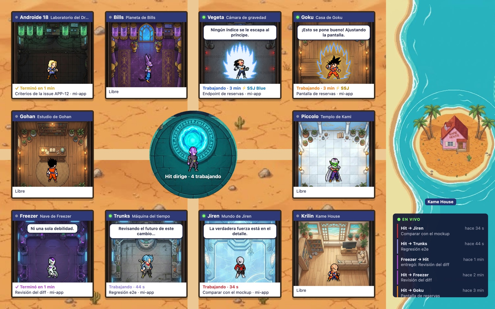

# equipo-dbs · Dragon Ball Super Agents

Un equipo de agentes para [Claude Code](https://claude.com/claude-code) (y Cursor) con personajes de Dragon Ball Super. Hit, el líder, toma una issue de Linear, la reparte entre diez especialistas, revisa lo que le devuelven, abre el PR y lo integra. Mientras tanto puedes ver al equipo trabajando en un mapa en el navegador y escuchar a cada personaje cuando entrega.



> Proyecto de fans, sin fines comerciales. Dragon Ball y sus personajes pertenecen a sus dueños (ver [Créditos](#créditos)).

## Qué trae

- **10 agentes especialistas** (`agents/`), que se invocan como `equipo-dbs:<rol>`.
- **Skill `resolver-issue`:** Hit toma una issue («toma la issue ABC-12»), aclara el objetivo y arma un plan. Delega en paralelo, pide revisión de seguridad, QA (con regresión e2e) y diseño, abre el PR y lo integra cuando todo está en verde.
- **Mapa** (skill `mapa`): una sala por especialista con su sprite. Cuando Hit delega, el personaje camina a su sala; cuando entrega, vuelve a la plaza. Al lado hay un feed «En vivo».
- **Panel** (`/equipo`): en la terminal, quién trabaja, en qué y cuánto lleva, con avatares de pixel art.
- **Voces:** cada personaje avisa con su frase al terminar y grita al transformarse. Suenan por turno, sin pisarse.
- **Transformaciones:** Hit ajusta la potencia de cada especialista según la dificultad de la tarea. **Super Saiyan** = `model: opus`. **Super Saiyan Blue** = `opus` con `effort: high`.

| Rol | Personaje | Para qué |
| --- | --- | --- |
| `producto` | Androide 18 | Objetivo, criterios de aceptación y alcance |
| `arquitecto` | Bills | Diseño e impacto antes de tocar contratos o varias capas |
| `backend` | Vegeta | Endpoints, servicios, datos y migraciones |
| `frontend` | Goku | Pantallas, estilos, accesibilidad y rendimiento |
| `fullstack` | Gohan | Un contrato nuevo de punta a punta |
| `devops` | Piccolo | CI, hosting, dependencias e integración de PRs |
| `seguridad` | Freezer | Revisión del diff: autorización, XSS, datos personales y secretos |
| `qa` | Trunks | Tests, navegador real y regresión e2e |
| `critico-diseno` | Jiren | Compara capturas con el mockup |
| `escritor` | Krilin | Descripción del PR y comentario de Linear |

## Requisitos

- Claude Code (o Cursor, sin mapa, panel ni voces).
- `git` y [`gh`](https://cli.github.com/) autenticado, para los PRs.
- Opcionales:
  - Servidor MCP de **Linear**, para leer y actualizar issues. Sin él, le pasas la tarea en el chat.
  - **CodeGraph**, que lo usa el arquitecto si está.
  - **Node 23.6 o más nuevo** y `jq`, para el mapa.
  - **macOS**, para las voces (`afplay` y `say`); en otros sistemas el plugin funciona en silencio.

No necesitas ninguna clave ni cuenta extra: los audios ya vienen en el repo.

## Instalación

### Claude Code

En el prompt de una sesión:

```
/plugin install equipo-dbs --marketplace alekings-dev/dragon-ball-super-agents
```

Responde `y` para agregar el marketplace y elige el alcance (usuario, por defecto). Desde la shell:

```sh
claude plugin install equipo-dbs --marketplace alekings-dev/dragon-ball-super-agents
```

En la app de escritorio: clic en **+** junto al cuadro del prompt → **Plugins** → **Add marketplace** con `alekings-dev/dragon-ball-super-agents` → **Add plugin**.

### Cursor

El mismo repo es un plugin de Cursor (`.cursor-plugin/`), con los agentes y las skills:

```sh
git clone https://github.com/alekings-dev/dragon-ball-super-agents ~/.cursor/plugins/local/dragon-ball-super-agents
```

Reinicia Cursor y revisa que aparezca en **Settings → Plugins**. Para actualizar: `git -C ~/.cursor/plugins/local/dragon-ball-super-agents pull`. Usa una carpeta real, no un enlace simbólico.

La primera vez que uses `resolver-issue` en un repo, Hit corre `configurar-modelos`. Te propone un modelo por nivel (Opus para Bills y Freezer; Sonnet para los implementadores, QA, producto y diseño; Haiku para el escritor) y lo deja en `.cursor/agents/<rol>.md`. Cursor ignora sin aviso los IDs de modelo que no reconoce, así que la skill solo usa los que confirmes.

## Primeros pasos

1. En tu repo, crea `.claude/equipo/proyecto.md` con lo propio del proyecto. Puedes usar la [plantilla](#plantilla-de-proyectomd). El equipo es genérico: todo lo específico del repo va en ese archivo.
2. Pídele a Claude: «toma la issue ABC-12» o `/equipo-dbs:resolver-issue ABC-12`.
3. Si quieres ver al equipo trabajando, pide «abre el mapa del equipo» o corre `node scripts/visor.mjs` desde la carpeta del plugin y abre <http://localhost:4321>.

Lo que aprende cada rol queda en `.claude/equipo/bitacora/<rol>.md` y lo leen en las issues siguientes. Versiona `.claude/equipo/` junto con tu código.

### Plantilla de `proyecto.md`

```markdown
# Proyecto: <nombre>

## Producto
Qué es, para quién, tono de los textos.

## Stack
Carpetas, frameworks y comandos (tests, tipos, build, levantar local, e2e).

## Git y PRs
- Rama base: `<base>`.
- Identidad de commits y prefijos de los mensajes.
- La persona a cargo es <nombre>.

## Linear
Equipo, proyecto y prefijo de issues.

## Límites
Usuarios de prueba, cómo se lee producción.

## Contexto
Documentos que el líder debe revisar (informe UX, mockups, decisiones previas).

## Verificaciones finales
Comandos que corre el líder antes del PR.

## Deploy
Cómo verifica devops el deploy tras integrar.

## Por rol
### backend
Patrones y carpetas propias. (Igual para otros roles si hace falta.)
```

## Cómo funciona

### Mapa

`hooks/evento.sh` anota cada delegación de Hit (`PreToolUse` de Agent) y cada entrega (`SubagentStop`) en `~/.claude/equipo-dbs/eventos.jsonl`. El archivo se recorta solo a las últimas 500 líneas y nunca sale de tu equipo.

`scripts/visor.mjs` sirve `visor/` en `http://localhost:4321` y transmite los eventos por SSE. Escucha solo en `127.0.0.1`. Los nombres, colores, frases y transformaciones salen de `hooks/equipo.ts`, el mismo archivo que usa el panel.

```sh
node scripts/visor.mjs [puerto]   # o la skill «mapa», que además abre el navegador
sh hooks/evento.test.sh           # prueba del hook
```

### Voces

`hooks/agente-termina.sh` (hooks `SubagentStop` y `Stop`) reproduce la frase de cada personaje cuando entrega. Hit habla cuando su respuesta trae la firma `(⌐■_■) Hit`. Si el reporte trae un bloqueo, como un hallazgo **Bloquea** o fallos nuevos en QA, suena la versión de alerta. `hooks/transformacion.sh` hace gritar al personaje cuando entra transformado.

Los hooks corren en paralelo, así que `hooks/turno.sh` da la palabra de a uno con un candado en `$TMPDIR`: nadie pisa a nadie, tampoco Hit. Prueba: `sh hooks/turno.test.sh`.

Los audios están en `hooks/voces/`. Para regenerarlos o cambiar frases, edita `hooks/voces.tsv` y `hooks/transformaciones.tsv`, y corre el script con **tu propia** clave de [Fish Audio](https://fish.audio). La clave solo se lee del entorno y nunca se guarda en el repo:

```sh
FISH_API_KEY=tu-clave sh hooks/generar-voces.sh      # -f para sobrescribir los que ya existen
```

Sin audios, el plugin usa la voz del sistema (`say`).

### Avatares y sprites

- **Avatares del panel:** son originales de pixel art (16×16), generados por `scripts/generar-avatares.py` en `hooks/avatares.ts`. Se dibujan en terminales con gráficos (Kitty, iTerm2, WezTerm, Ghostty); en las demás aparece la carita del personaje.
- **Personajes del mapa:** son sprites de fans. `scripts/importar-sprites.py` les quita el fondo y arma una hoja por rol (quieto, camina, aura, entrega, caída); requiere Pillow.
- **Fondos del mapa:** son ilustraciones generadas con IA, en `visor/fondos/`.

## Créditos

- Sprites del mapa: colección de fans «Dragon Ball Sagas», con el autor de cada uno en [`visor/sprites/CREDITOS.md`](visor/sprites/CREDITOS.md).
- Voces: generadas con voces públicas de [Fish Audio](https://fish.audio).
- Dragon Ball, Dragon Ball Super y sus personajes son propiedad de sus respectivos dueños. Este es un proyecto de fans, sin fines comerciales y sin afiliación con ellos.

## Licencia

El código y la documentación están bajo [MIT](LICENSE). La licencia no cubre los personajes de Dragon Ball, los sprites de fans (`visor/sprites/`), los fondos (`visor/fondos/`) ni los audios (`hooks/voces/`).
