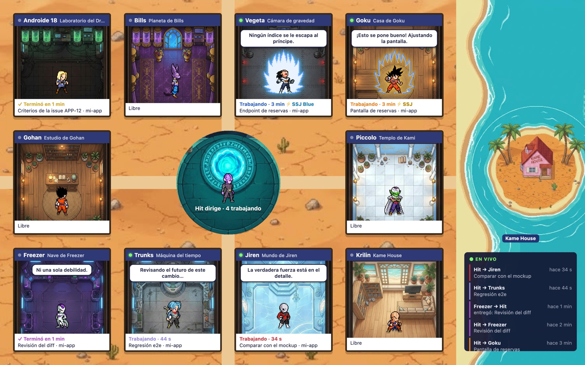

# equipo-dbs · Dragon Ball Super Agents

**Español** · [English](README.en.md)

Un equipo de agentes para [Claude Code](https://claude.com/claude-code), Cursor y [OpenCode](https://opencode.ai) con personajes de Dragon Ball Super. Hit, el líder, toma una issue de Linear, la reparte entre diez especialistas, revisa lo que le devuelven, abre el PR y lo integra. Mientras tanto puedes ver al equipo trabajando en un mapa en el navegador y escuchar a cada personaje cuando entrega.



> Proyecto de fans, sin fines comerciales. Dragon Ball y sus personajes pertenecen a sus dueños (ver [Créditos](#créditos)).

> **Novedades 0.10.2:** en Claude Code, `producto` precarga `design:ux-copy` y `arquitecto` precarga `ponytail:ponytail-review`, solo como guías. Son opcionales: sin los plugins `design` o `ponytail`, la precarga se omite. OpenCode no las usa.
>
> **Novedades 0.10.1:** en Claude Code, `critico-diseno` precarga la skill `design:accessibility-review` (WCAG 2.1 AA) como lista de comprobación. Es opcional: si no tienes el plugin `design`, la precarga se omite. OpenCode no la usa.
>
> **Novedades 0.10.0:** el repo ahora también es un plugin de **OpenCode V2**. Trae los 10 agentes, las 3 skills, los comandos `/resolver-issue`, `/mapa` y `/configurar-modelos`, el panel `/equipo` en la TUI, voces y mapa. Claude Code y Cursor siguen funcionando igual.

## Qué trae

- **10 agentes especialistas** (`agents/`), que se invocan como `equipo-dbs:<rol>` en Claude Code/Cursor y `equipo-dbs/<rol>` en OpenCode.
- **Skill `resolver-issue`:** Hit toma una issue («toma la issue ABC-12» o `/resolver-issue ABC-12` en OpenCode), aclara el objetivo y arma un plan. Delega en paralelo, pide revisión de seguridad, QA (con regresión e2e) y diseño, abre el PR y lo integra cuando todo está en verde.
- **Mapa** (skill `mapa`): una sala por especialista con su sprite. Cuando Hit delega, el personaje camina a su sala; cuando entrega, vuelve a la plaza. Al lado hay un feed «En vivo».
- **Panel** (`/equipo`): en la terminal de Claude Code, quién trabaja, en qué y cuánto lleva, con avatares de pixel art. En la TUI de OpenCode muestra lo mismo con las caritas del equipo.
- **Voces:** cada personaje avisa con su frase al terminar y grita al transformarse. Suenan por turno, sin pisarse.
- **Transformaciones:** Hit ajusta la potencia de cada especialista según la dificultad de la tarea. **Super Saiyan** = `model: opus`. **Super Saiyan Blue** = `opus` con `effort: high` (en OpenCode, `provider/modelo#high`).

| Función | Claude Code | Cursor | OpenCode |
| --- | --- | --- | --- |
| 10 agentes | ✅ | ✅ | ✅ |
| Skills | ✅ | ✅ | ✅ |
| Panel | ✅ pixel art | — | ✅ caritas (TUI) |
| Voces | ✅ macOS | — | ✅ macOS |
| Mapa | ✅ | — | ✅ |
| Comandos | `/equipo-dbs:*` | — | `/resolver-issue`, `/mapa`, `/configurar-modelos`, `/equipo` |

| Rol | Personaje | Para qué |
| --- | --- | --- |
| `producto` | Androide 18 | Objetivo, criterios de aceptación y alcance |
| `arquitecto` | Bills | Diseño e impacto antes de tocar contratos o varias capas |
| `backend` | Vegeta | Endpoints, servicios, datos y migraciones |
| `frontend` | Goku | Pantallas, estilos, accesibilidad y rendimiento |
| `fullstack` | Gohan | Un contrato nuevo de punta a punta |
| `devops` | Piccolo | CI, hosting, dependencias e integración de PRs |
| `seguridad` | Freezer | Revisión del diff: autorización, XSS, datos personales y secretos |
| `qa` | Trunks | Tests, navegador real y regresión e2e |
| `critico-diseno` | Jiren | Compara capturas con el mockup |
| `escritor` | Krilin | Descripción del PR y comentario de Linear |

## Requisitos

- Claude Code, Cursor u OpenCode 2.3 o más nuevo. En Cursor no hay mapa, panel ni voces; en OpenCode el panel es de la TUI y no tiene avatares pixel-art.
- `git` y [`gh`](https://cli.github.com/) autenticado, para los PRs.
- Opcionales:
  - Servidor MCP de **Linear**, para leer y actualizar issues. Sin él, le pasas la tarea en el chat.
  - **CodeGraph**, que lo usa el arquitecto si está.
  - **Node 23.6 o más nuevo** para el mapa; `jq` para los hooks de Claude Code y para las voces.
  - **macOS**, para las voces (`afplay` y `say`); en otros sistemas el plugin funciona en silencio.

No necesitas ninguna clave ni cuenta extra: los audios ya vienen en el repo.

## Instalación

### Claude Code

En el prompt de una sesión:

```
/plugin install equipo-dbs --marketplace alekings-dev/dragon-ball-super-agents
```

Responde `y` para agregar el marketplace y elige el alcance (usuario, por defecto). Desde la shell:

```sh
claude plugin install equipo-dbs --marketplace alekings-dev/dragon-ball-super-agents
```

En la app de escritorio: clic en **+** junto al cuadro del prompt → **Plugins** → **Add marketplace** con `alekings-dev/dragon-ball-super-agents` → **Add plugin**.

### Cursor

El mismo repo es un plugin de Cursor (`.cursor-plugin/`), con los agentes y las skills:

```sh
git clone https://github.com/alekings-dev/dragon-ball-super-agents ~/.cursor/plugins/local/dragon-ball-super-agents
```

Reinicia Cursor y revisa que aparezca en **Settings → Plugins**. Para actualizar: `git -C ~/.cursor/plugins/local/dragon-ball-super-agents pull`. Usa una carpeta real, no un enlace simbólico.

La primera vez que uses `resolver-issue` en un repo, Hit corre `configurar-modelos`. Te propone un modelo por nivel (Opus para Bills y Freezer; Sonnet para los implementadores, QA, producto y diseño; Haiku para el escritor) y lo deja en `.cursor/agents/<rol>.md`. Cursor ignora sin aviso los IDs de modelo que no reconoce, así que la skill solo usa los que confirmes.

### OpenCode

El repo es un plugin de **OpenCode V2** (2.3 o más nuevo) con server part y TUI part. El plugin registra las skills y los comandos, y copia los agentes a tu configuración.

#### Como paquete (recomendado)

```sh
opencode plugin add github:alekings-dev/dragon-ball-super-agents
```

Al cargar por primera vez, instala los agentes que falten en `~/.config/opencode/agents/equipo-dbs/` y recarga la lista. No pisa los que ya existan.

#### Como directorio local

```sh
git clone https://github.com/alekings-dev/dragon-ball-super-agents ~/.config/opencode/plugins/dragon-ball-super-agents
```

Y añade la ruta absoluta a `opencode.json(c)`:

```jsonc
{
  "$schema": "https://opencode.ai/config.json",
  "plugins": ["/Users/tu-usuario/.config/opencode/plugins/dragon-ball-super-agents"]
}
```

OpenCode también descubre paquetes dentro de `~/.config/opencode/plugins/` y `.opencode/plugins/`.

#### Dónde viven los agentes

| Opción | Qué hace |
| --- | --- |
| `"global"` (por defecto) | Los instala en `~/.config/opencode/agents/equipo-dbs/` |
| `"project"` | Los instala en `<proyecto>/.opencode/agents/equipo-dbs/` |
| `"off"` | No instala nada; útil si los versionas en el repo |

```jsonc
{
  "plugins": [
    { "package": "/ruta/al/repo", "options": { "agents": "project" } }
  ]
}
```

Para instalarlos o actualizarlos a mano (desde un clon del repo):

```sh
node opencode/scripts/instalar-agentes.mjs --global
node opencode/scripts/instalar-agentes.mjs --project /ruta/al/repo --force
```

#### Comandos y skills

| Acción | OpenCode |
| --- | --- |
| Tomar una issue | `/resolver-issue ABC-12` |
| Abrir el mapa | `/mapa` |
| Elegir modelos | `/configurar-modelos` |
| Ver el panel | `/equipo` (solo TUI) |
| Cargar una skill | `@resolver-issue`, `@mapa`, `@configurar-modelos` |

Los agentes se llaman `equipo-dbs/<rol>` (por ejemplo `equipo-dbs/backend`). Hit sigue siendo el agente principal o la skill: no lo conviertas en `mode: subagent`, porque el anidamiento por defecto es de un nivel y no podría lanzar a los especialistas.

#### Modelos

Los valores por defecto están en `opencode/modelos.json`:

```json
{
  "opus": "opencode/claude-opus-5-5",
  "sonnet": "opencode/claude-sonnet-5-5",
  "haiku": "opencode/claude-haiku-5-5"
}
```

Cámbialos por los IDs de tu proveedor (los lista `opencode models`). Después:

```sh
node opencode/scripts/generar-agentes.mjs
node opencode/scripts/instalar-agentes.mjs --global --force
```

También puedes editar solo la línea `model:` de cada agente instalado o correr `/configurar-modelos`. Para Super Saiyan Blue usa una variante: `opencode/claude-opus-5-5#high`.

#### Qué funciona y qué cambia

| Pieza | En OpenCode |
| --- | --- |
| Agentes | ✅ 10 subagentes `equipo-dbs/<rol>` |
| Skills y comandos | ✅ registrados por el plugin |
| Panel | ✅ `/equipo` en la TUI, con caritas (sin avatares pixel-art) |
| Voces | ✅ macOS + `jq`; reutiliza los scripts |
| Mapa | ✅ mismo visor; el plugin escribe `eventos.jsonl` |
| Transformaciones | ✅ `provider/modelo#high` |

Diferencias a tener en cuenta:

- Los subagentes de OpenCode **no bloquean**: `subagent` devuelve un `sessionID` y el reporte llega después como mensaje `<subagent>`.
- Los MCP cambian de nombre: `mcp__linear-server__get_issue` pasa a `linear-server_get_issue`.
- Los `tools:` de Claude se traducen a `permissions`: los agentes de solo lectura tienen `edit` denegado y los que no usan `Bash` tienen `shell` denegado.
- El panel solo existe en la TUI; en la app de escritorio no hay panel.

Si algo no aparece: `/reload`, revisa `~/.config/opencode/agents/equipo-dbs/` y corre el instalador. La guía detallada está en [docs/opencode.md](docs/opencode.md).

## Primeros pasos

1. En tu repo, crea `.claude/equipo/proyecto.md` con lo propio del proyecto. Puedes usar la [plantilla](#plantilla-de-proyectomd). El equipo es genérico: todo lo específico del repo va en ese archivo.
2. Pídele a Claude: «toma la issue ABC-12» o `/equipo-dbs:resolver-issue ABC-12`. En OpenCode: `/resolver-issue ABC-12`.
3. Si quieres ver al equipo trabajando, pide «abre el mapa del equipo», usa `/mapa` en OpenCode o corre `node scripts/visor.mjs` desde la carpeta del plugin y abre <http://localhost:4321>.

Lo que aprende cada rol queda en `.claude/equipo/bitacora/<rol>.md` y lo leen en las issues siguientes. Versiona `.claude/equipo/` junto con tu código.

### Plantilla de `proyecto.md`

```markdown
# Proyecto: <nombre>

## Producto
Qué es, para quién, tono de los textos.

## Stack
Carpetas, frameworks y comandos (tests, tipos, build, levantar local, e2e).

## Git y PRs
- Rama base: `<base>`.
- Identidad de commits y prefijos de los mensajes.
- La persona a cargo es <nombre>.

## Linear
Equipo, proyecto y prefijo de issues.

## Límites
Usuarios de prueba, cómo se lee producción.

## Contexto
Documentos que el líder debe revisar (informe UX, mockups, decisiones previas).

## Verificaciones finales
Comandos que corre el líder antes del PR.

## Deploy
Cómo verifica devops el deploy tras integrar.

## Por rol
### backend
Patrones y carpetas propias. (Igual para otros roles si hace falta.)
```

## Cómo funciona

### Mapa

`hooks/evento.sh` anota cada delegación de Hit (`PreToolUse` de Agent) y cada entrega (`SubagentStop`) en `~/.claude/equipo-dbs/eventos.jsonl`. En OpenCode lo escribe el propio plugin con el mismo formato (sin `jq`). El archivo se recorta solo a las últimas 500 líneas y nunca sale de tu equipo.

`scripts/visor.mjs` sirve `visor/` en `http://localhost:4321` y transmite los eventos por SSE. Escucha solo en `127.0.0.1`. Los nombres, colores, frases y transformaciones salen de `hooks/equipo.ts`, el mismo archivo que usa el panel.

```sh
node scripts/visor.mjs [puerto]   # o la skill «mapa», que además abre el navegador
sh hooks/evento.test.sh           # prueba del hook
```

### Voces

`hooks/agente-termina.sh` (hooks `SubagentStop` y `Stop`) reproduce la frase de cada personaje cuando entrega. Hit habla cuando su respuesta trae la firma `(⌐■_■) Hit`. Si el reporte trae un bloqueo, como un hallazgo **Bloquea** o fallos nuevos en QA, suena la versión de alerta. `hooks/transformacion.sh` hace gritar al personaje cuando entra transformado. En OpenCode el plugin invoca estos mismos scripts al terminar cada sesión hija.

Los hooks corren en paralelo, así que `hooks/turno.sh` da la palabra de a uno con un candado en `$TMPDIR`: nadie pisa a nadie, tampoco Hit. Prueba: `sh hooks/turno.test.sh`.

Los audios están en `hooks/voces/`. Para regenerarlos o cambiar frases, edita `hooks/voces.tsv` y `hooks/transformaciones.tsv`, y corre el script con **tu propia** clave de [Fish Audio](https://fish.audio). La clave solo se lee del entorno y nunca se guarda en el repo:

```sh
FISH_API_KEY=tu-clave sh hooks/generar-voces.sh      # -f para sobrescribir los que ya existen
```

Sin audios, el plugin usa la voz del sistema (`say`).

### Avatares y sprites

- **Avatares del panel:** son originales de pixel art (16×16), generados por `scripts/generar-avatares.py` en `hooks/avatares.ts`. Se dibujan en terminales con gráficos (Kitty, iTerm2, WezTerm, Ghostty); en las demás aparece la carita del personaje. Solo Claude Code; el panel de OpenCode usa siempre la carita.
- **Personajes del mapa:** son sprites de fans. `scripts/importar-sprites.py` les quita el fondo y arma una hoja por rol (quieto, camina, aura, entrega, caída); requiere Pillow.
- **Fondos del mapa:** son ilustraciones generadas con IA, en `visor/fondos/`.

### Plugin de OpenCode

La compatibilidad con OpenCode vive en `opencode/`:

- `package.json` (raíz): manifiesto npm con `exports` para el server part y el TUI part; es lo que permite `opencode plugin add`.
- `opencode/src/index.ts`: server part; registra skills y comandos, instala agentes, conecta los hooks de `subagent` y escucha `session.execution.*`.
- `opencode/src/tui.tsx`: panel `/equipo` de la TUI.
- `opencode/agentes/equipo-dbs/`: los 10 agentes generados desde `agents/`.
- `opencode/scripts/generar-agentes.mjs`: traduce el frontmatter de Claude/Cursor a OpenCode; `--check` falla si hay desincronización.
- `opencode/scripts/instalar-agentes.mjs`: instala o actualiza los agentes en la configuración global o del proyecto.
- `opencode/modelos.json`: modelos por nivel (`opus`, `sonnet`, `haiku`).
- `opencode/test/`: pruebas de la normalización de roles/modelos y de la sincronización de agentes.
- `docs/opencode.md`: guía detallada de instalación, modelos, diferencias y problemas comunes.

Los agentes de Claude/Cursor son la fuente; después de editarlos, corre `node opencode/scripts/generar-agentes.mjs`.

### Pruebas

```sh
sh hooks/evento.test.sh
sh hooks/turno.test.sh
node --test opencode/test/*.test.mjs
node opencode/scripts/generar-agentes.mjs --check
```

## Créditos

- Sprites del mapa: colección de fans «Dragon Ball Sagas», con el autor de cada uno en [`visor/sprites/CREDITOS.md`](visor/sprites/CREDITOS.md).
- Voces: generadas con voces públicas de [Fish Audio](https://fish.audio).
- Dragon Ball, Dragon Ball Super y sus personajes son propiedad de sus respectivos dueños. Este es un proyecto de fans, sin fines comerciales y sin afiliación con ellos.

## Licencia

El código y la documentación están bajo [MIT](LICENSE). La licencia no cubre los personajes de Dragon Ball, los sprites de fans (`visor/sprites/`), los fondos (`visor/fondos/`) ni los audios (`hooks/voces/`).
